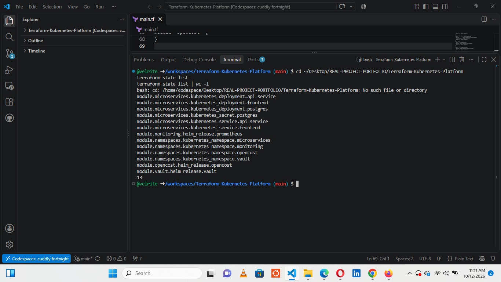
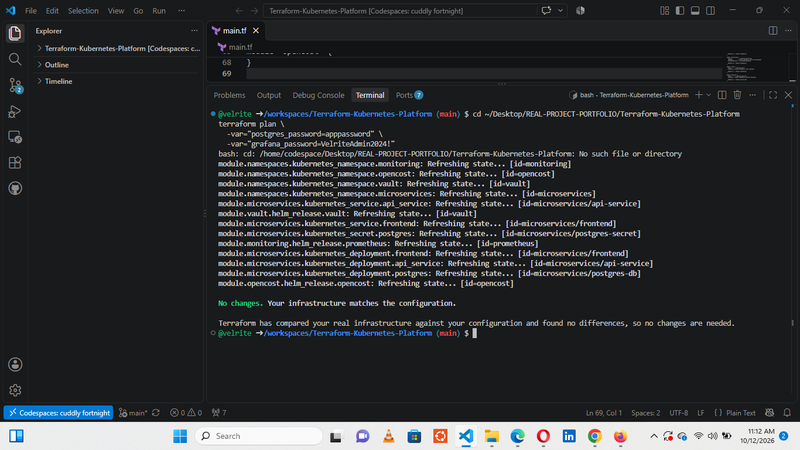
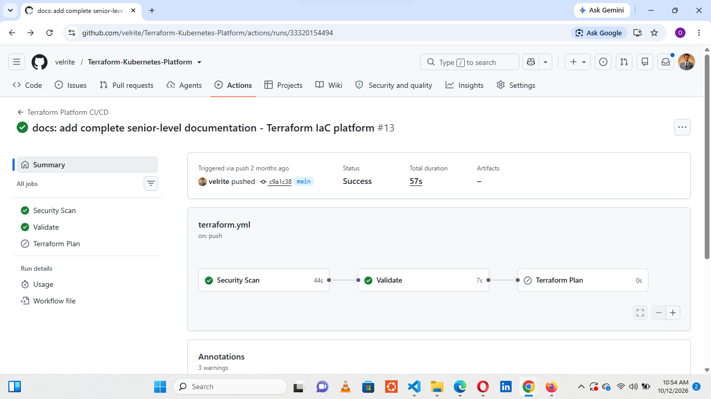
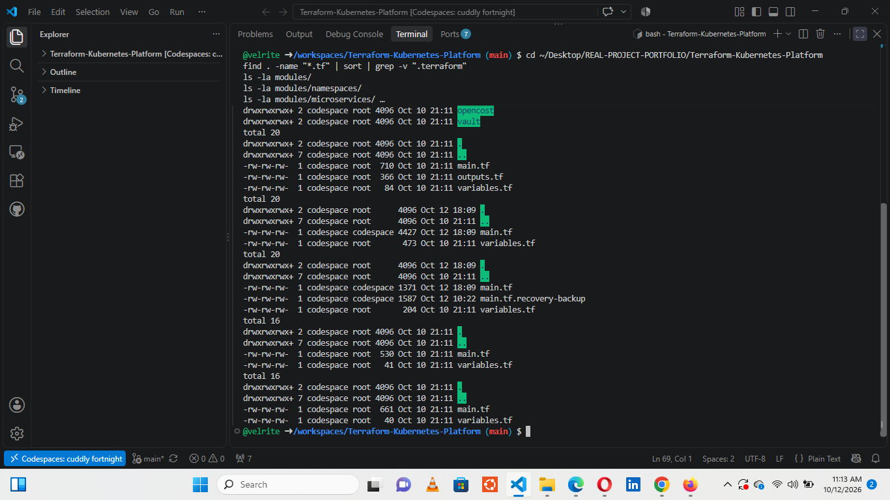
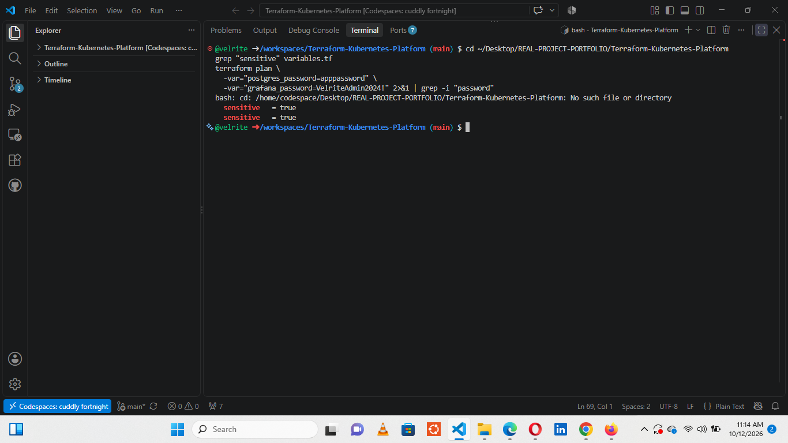
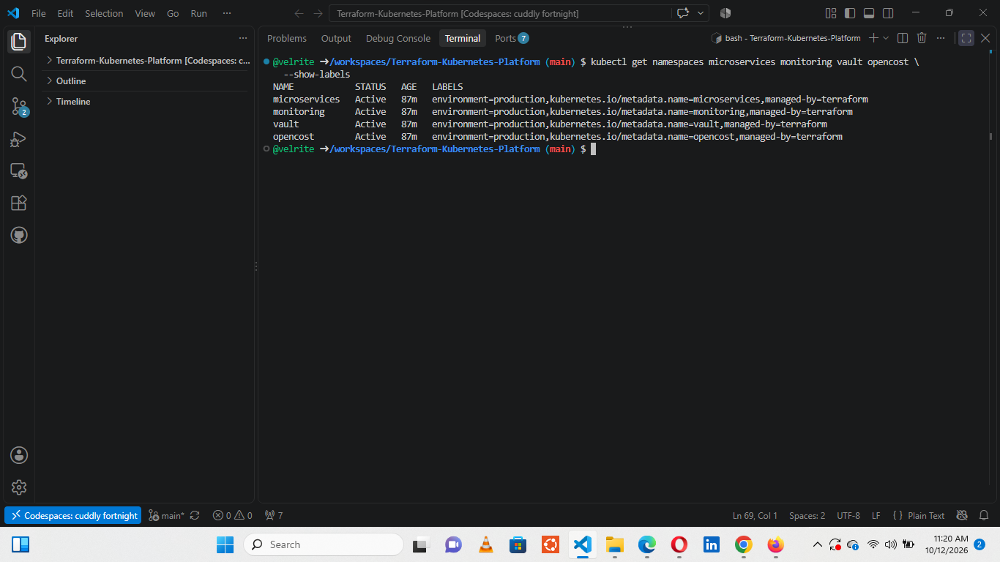
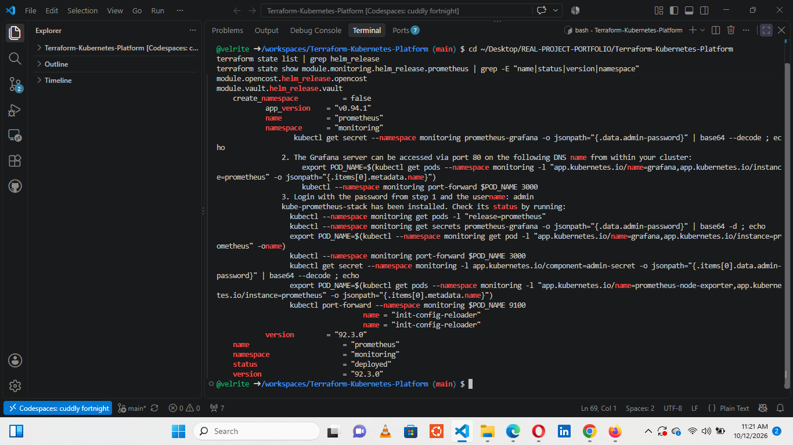

# Terraform Kubernetes Platform: Infrastructure as Code

I rebuilt the platform from my [Auto-Healing Kubernetes project](https://github.com/velrite/Auto-Healing-Kubernetes-Platform) as Terraform, to answer one question with evidence instead of a claim: can a platform be reproduced from code, rather than from commands someone remembers?

**Status:** All 13 platform resources are defined in Terraform across 5 modules. On the original build they were applied and checked (`terraform state list` returned 13, `terraform plan` returned no changes) and the CI pipeline ran green. The original Codespace was later deleted, so the evidence is being recaptured on a rebuilt cluster: **7 of 8 screenshots are captured** and the [evidence index](docs/evidence/README.md) marks the rest as pending. A destroy-and-reapply round trip has not been recorded as an experiment yet. Nothing in this repository claims remote state, workspaces or automated apply.

**Author:** Olamide Olalekan, Platform & DevSecOps Engineer | [GitHub](https://github.com/velrite) | [LinkedIn](https://linkedin.com/in/olamide-olalekan-12138a265) | velrite.tech@gmail.com

---

## In Plain Terms

When infrastructure is built by typing commands, the only record of what exists is someone's memory or terminal history. Here the Terraform files are the record. Anyone with the repository and the credentials can see exactly what the platform consists of and recreate it without asking anyone which commands to run.

---

## Engineering Problem

The Auto-Healing project was built by hand: `kubectl create namespace`, `helm install`, `kubectl apply`. It worked, but rebuilding it after losing the cluster meant reconstructing the order of every command from notes.

This project moves that knowledge out of memory and into code, and sets the bar before any work started:

- `terraform state list | wc -l` returns 13
- `terraform plan` returns "No changes"
- no credential appears in plan output or anywhere in Git history
- the CI pipeline scans for secrets before it validates anything

---

## What Terraform Manages (13 resources)

| #  | Resource              | Type                   | Module        |
| -- | --------------------- | ---------------------- | ------------- |
| 1  | microservices         | kubernetes_namespace   | namespaces    |
| 2  | monitoring            | kubernetes_namespace   | namespaces    |
| 3  | vault                 | kubernetes_namespace   | namespaces    |
| 4  | opencost              | kubernetes_namespace   | namespaces    |
| 5  | postgres-secret       | kubernetes_secret      | microservices |
| 6  | postgres-db           | kubernetes_deployment  | microservices |
| 7  | api-service           | kubernetes_deployment  | microservices |
| 8  | frontend              | kubernetes_deployment  | microservices |
| 9  | api-service ClusterIP | kubernetes_service     | microservices |
| 10 | frontend NodePort     | kubernetes_service     | microservices |
| 11 | Prometheus + Grafana  | helm_release           | monitoring    |
| 12 | HashiCorp Vault (dev) | helm_release           | vault         |
| 13 | OpenCost              | helm_release           | opencost      |

---

## Architecture


module.namespaces
|-- module.microservices (pods need their namespace)
|-- module.monitoring (Helm release targets the monitoring namespace)
|-- module.vault (Helm release targets the vault namespace)

module.monitoring
|-- module.opencost (OpenCost reads cost data from this Prometheus)


Both the `kubernetes` and `helm` providers read the `prod-sim` context from the kubeconfig that `minikube start --profile=prod-sim` creates. The cluster must exist before `terraform apply`. Details: [docs/ARCHITECTURE.md](docs/ARCHITECTURE.md).

---

## Claim Status

| Claim | Status | Evidence |
| ----- | ------ | -------- |
| 13 resources defined in Terraform and applied | Verified on the original build, recapture in progress | 01 |
| `terraform plan` shows no changes | Verified on the original build, recapture in progress | 02 |
| 5 modules, one platform concern each | Verified from the repository | 03 |
| Credentials typed `sensitive = true`, values from a gitignored file | Configured, redaction checked in evidence 04 | 04 |
| Leaked password removed from Git history | Verified by a history search | 06 |
| CI runs Security Scan, then Validate | Verified on the original run | 05 |
| Destroy then apply reproduces the platform | Not recorded yet | none |
| Remote state, workspaces, apply from CI | Not built | [GAPS](docs/GAPS.md) |

---

## Security: Sensitive Variables

```hcl
variable "postgres_password" {
  type      = string
  sensitive = true
}
```

`sensitive = true` stops Terraform printing the value in plan or apply output. It does not encrypt it: the value is stored in plaintext in `terraform.tfstate`. The real controls are therefore two: values live in a gitignored `terraform.tfvars`, and the state file is gitignored and treated as a secret. Details: [docs/SECURITY.md](docs/SECURITY.md).

---

## The Incident That Shaped the Security Model

A Grafana admin password was written directly in `main.tf` and pushed to this public repository ([Incident 1](docs/INCIDENTS.md)).

**Response.** Replaced the value with `var.grafana_password`, moved the value to the gitignored tfvars file, rewrote all history with `git-filter-repo`, force-pushed, and searched every commit on every branch for the old string. The search returned nothing.

**What it taught me.** Deleting a secret from a file does not remove it from history, and rewriting history does not recall copies that were already public. The reliable prevention is the variable pattern, not detection after the push. The leaked value was a Grafana admin password for a lab cluster that is rebuilt regularly.

---

## CI/CD Security Pipeline

push to main
|
+-- Security Scan TruffleHog (secrets), tfsec (Terraform misconfiguration), Checkov (policy)
|
+-- Validate terraform fmt -check, terraform init -backend=false, terraform validate


The security job runs first so a pipeline that finds a credential stops before spending time on validation. Validate uses dummy variable values because no cluster exists in CI. Apply is not in the pipeline: a GitHub-hosted runner cannot reach a Minikube cluster inside a Codespace.

---

## Decisions

| ADR | Decision | Cost accepted |
| --- | -------- | ------------- |
| 001 | Modules per platform concern, not one flat file | One more layer to navigate |
| 002 | Local state, not S3 + DynamoDB | No team sharing, state is lost with the machine |
| 003 | Explicit `depends_on` between modules | Terraform waits for a whole module, less parallelism |
| 004 | `helm_release` for the three tools, not raw manifests | Helm contents are opaque to Terraform state |
| 005 | `set` blocks for limits and secrets, not a values file | Verbose for many values |

Full reasoning, alternatives and production view: [docs/ADR.md](docs/ADR.md).

---

## Failure Catalogue

**Credential in public history.** Found during review, fixed by history rewrite, verified by a full-history search. ([Incident 1](docs/INCIDENTS.md))

**Corrupted module files.** Pasting long heredocs into a browser terminal dropped and interleaved characters. The files looked created but were garbage, and `terraform plan` showed 0 resources. Fixed by writing files in the editor. ([Incident 2](docs/INCIDENTS.md))

**Apply that created nothing.** After repairing the corrupted files, `namespaces/main.tf` held root module calls instead of namespace resources. Terraform found nothing to create and reported success. Found by reading the file, fixed, reapplied. ([Incident 3](docs/INCIDENTS.md))

---

## Known Limitations

- State is local and gitignored. If the machine is lost, Terraform no longer knows it owns the cluster resources, and a fresh apply fails with "already exists" until they are imported. The import procedure is written down in the [runbook](docs/RUNBOOK.md) but has not been exercised.
- The destroy-and-reapply round trip is the experiment this project exists to run, and it has not been recorded.
- Helm releases are opaque: Terraform tracks the release, not the 40-plus Kubernetes objects inside the prometheus release. A manually deleted object inside a release does not show in `terraform plan`.
- HPA, Prometheus alert rules, Vault configuration and the Minikube cluster itself are outside Terraform.
- Vault runs in dev mode, so its data does not survive a restart.
- No workspaces, so there is a single environment.
- tfsec and Checkov run with `soft_fail: true` in the workflow file, so they report findings but do not fail the pipeline. Only TruffleHog and the Validate stage can turn it red.
- TruffleHog runs with `--only-verified`, which reports only credentials it can confirm are live with the issuing service. A self-chosen password has nothing to verify against, so this pipeline would likely not flag the kind of secret that was leaked in Incident 1.
- Some actions in the workflow are referenced by branch (`@main`, `@master`) instead of a pinned version or commit SHA, so an upstream change alters the pipeline without a commit here.

Full register with the production change for each: [docs/GAPS.md](docs/GAPS.md).

---

## Production-Shaped, Not Production-Claimed

This is an independently built engineering project on a local Minikube cluster, not infrastructure serving customers. It uses production practices: modules, explicit dependencies, typed secrets, a scan-first pipeline, decision records and an incident log. It does not claim team-ready state management, automated apply or multi-environment support.

---

## Repository Layout

main.tf, variables.tf providers and module calls
terraform.tfvars.example placeholder values (the real terraform.tfvars is gitignored)
modules/ namespaces, microservices, monitoring, vault, opencost
.github/workflows/ terraform.yml, the CI pipeline
docs/ architecture, security, ADRs, incidents, gaps, runbook
docs/evidence/ screenshots and the evidence index


## Documentation

| File | Contents |
| ---- | -------- |
| [docs/index.md](docs/index.md) | Map of the documentation |
| [docs/ARCHITECTURE.md](docs/ARCHITECTURE.md) | State, providers, dependency order, what Terraform does not manage |
| [docs/SECURITY.md](docs/SECURITY.md) | Sensitive variables, state handling, the credential incident, CI scanning |
| [docs/ADR.md](docs/ADR.md) | Five decisions with alternatives and trade-offs |
| [docs/INCIDENTS.md](docs/INCIDENTS.md) | Three incidents: symptom, root cause, fix, verification |
| [docs/GAPS.md](docs/GAPS.md) | What is not built and what production would change |
| [docs/RUNBOOK.md](docs/RUNBOOK.md) | Build, verify, destroy, recover from lost state |

## Evidence

Headline captures are below. Every screenshot is listed with what it proves, the command and the expected result in the **[evidence index](docs/evidence/README.md)**. Screenshots not yet recaptured are marked pending there rather than shown broken.

<table><tr><td width="50%" align="center"><a href="docs/evidence/01-terraform-state-list.png"></a><br><sub>Terraform state list</sub></td><td width="50%" align="center"><a href="docs/evidence/02-terraform-plan-no-changes.png"></a><br><sub>Terraform plan, no changes</sub></td></tr><tr><td width="50%" align="center"><a href="docs/evidence/05-ci-pipeline-green.png"></a><br><sub>CI pipeline green</sub></td></tr></table>

<details><summary>Show all captured screenshots (7 of 8)</summary>

**01-terraform-state-list**

[](docs/evidence/01-terraform-state-list.png)

**02-terraform-plan-no-changes**

[](docs/evidence/02-terraform-plan-no-changes.png)

**03-module-structure**

[](docs/evidence/03-module-structure.png)

**04-sensitive-variables**

[](docs/evidence/04-sensitive-variables.png)

**05-ci-pipeline-green**

[](docs/evidence/05-ci-pipeline-green.png)

**07-terraform-namespaces**

[](docs/evidence/07-terraform-namespaces.png)

**08-helm-releases-state**

[](docs/evidence/08-helm-releases-state.png)

</details>

## Running It

Prerequisites: Terraform 1.7 or later, the Minikube cluster from the Auto-Healing project with the `prod-sim` kubeconfig context, `kubectl` and `helm`.

```bash
minikube start --profile=prod-sim
kubectl config current-context        # expect: prod-sim
cp terraform.tfvars.example terraform.tfvars   # then set real values
terraform init
terraform plan
terraform apply
terraform state list | wc -l          # expect: 13
```

Values are read from `terraform.tfvars` automatically, so no password needs to appear on the command line. Teardown is `terraform destroy`.

## Related Projects

- [Auto-Healing Kubernetes Platform](https://github.com/velrite/Auto-Healing-Kubernetes-Platform): the platform this provisions
- [Atlas](https://github.com/velrite/atlas): distributed resilience platform on GCP
- [Forge](https://github.com/velrite/forge): internal developer platform on GKE
